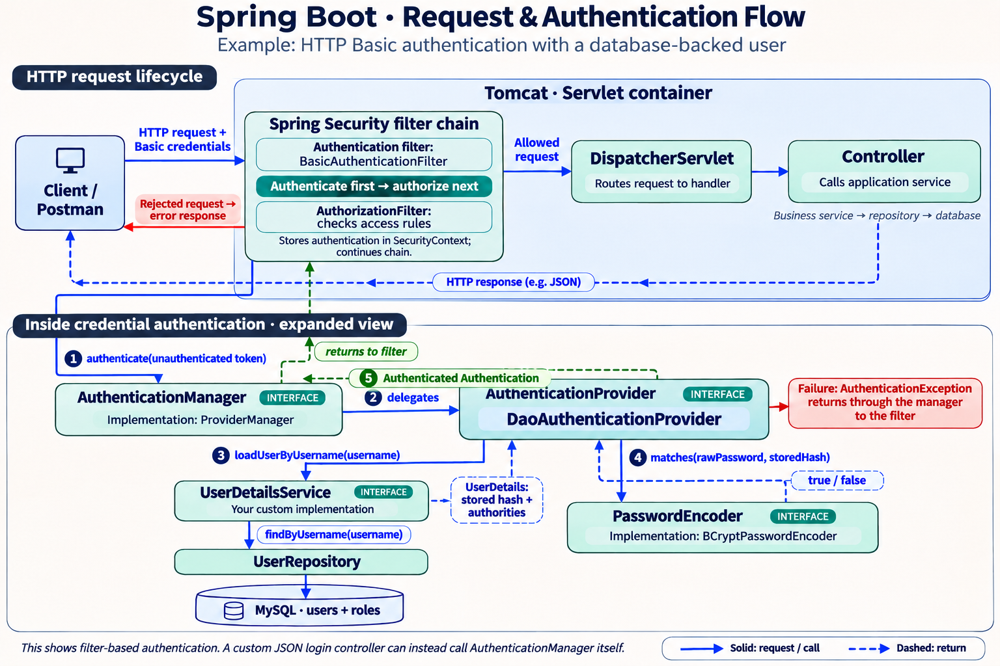

# Spring Boot: Request and Authentication Architecture



The diagram shows **one HTTP request being checked by Spring Security before Spring MVC runs your controller**. The bottom half expands the authentication work performed inside the security filters; it is not a second request.

We will follow this example:

```http
GET /api/patients?id=7
```

Suppose the caller supplies valid HTTP Basic credentials for a user named `mihir`, whose database role is `USER`.

The diagram assumes you have connected Spring Security to your database through a custom `UserDetailsService`. Creating a `User` entity and saving accounts through `AuthService` alone does not make Spring Security authenticate against those accounts.

## 1. Before the request: application startup

During startup, the application context creates and connects the required objects: your controllers, services, repository proxies, password encoder, and security infrastructure.

For example, your `AuthService` already holds references to its injected dependencies. Spring normally reuses those singleton beans across requests; it does not construct a new service for every Postman request.

Your `RoleDataInitializer.run()` also executes during startup to ensure the role records exist. It does not execute every time someone logs in.

Once startup finishes, Tomcat is listening for HTTP requests, typically on port `8080`.

## 2. Postman sends the operation and credentials

The request identifies the operation through the HTTP method and URL:

```http
GET /api/patients?id=7 HTTP/1.1
Host: localhost:8080
Authorization: Basic <base64-encoded-username-and-password>
```

When you select **Basic Auth** in Postman, Postman constructs that `Authorization` header.

Basic authentication represents `username:password` using Base64. Base64 is reversible encoding, so HTTPS is what protects those credentials while travelling over a network.

The credentials and the business operation have different purposes: the credentials identify the caller, while `/api/patients?id=7` identifies the patient data being requested.

There does not have to be a separate `/login` call for this Basic Auth flow. Credentials can accompany the request for the protected resource itself.

## 3. Tomcat receives the request

Tomcat is the servlet container. It handles the HTTP connection and provides request and response objects that Java web components can use:

```java
HttpServletRequest request;
HttpServletResponse response;
```

These objects expose information such as the URL, headers, query parameters, request body, and response status.

The large Tomcat boundary in the diagram means that the filters and `DispatcherServlet` participate in request processing inside that container. Controllers and services are Spring-managed objects invoked during that processing.

These components usually run in the same Java application. Arrows between them generally represent Java method calls, not network requests.

## 4. Security filters run before DispatcherServlet

A filter can inspect a request and either continue processing or stop it with a response. Calling:

```java
chain.doFilter(request, response);
```

passes control to the next filter or eventually to the servlet.

The diagram simplifies the security machinery. More precisely, the connection is:

```text
Tomcat's filter chain
    → DelegatingFilterProxy
    → FilterChainProxy
    → Matching SecurityFilterChain
    → Security filters
    → DispatcherServlet
```

`DelegatingFilterProxy` connects servlet filter processing to Spring-managed security infrastructure. `FilterChainProxy` selects the first matching `SecurityFilterChain`, which determines the security filters to execute.

The image highlights authentication and authorization. Actual chains can also contain filters for CSRF, security headers, context handling, and other responsibilities.

Reference: [Spring Security filter architecture](https://docs.spring.io/spring-security/reference/servlet/architecture.html).

## 5. BasicAuthenticationFilter extracts the credentials

Because this example uses HTTP Basic, `BasicAuthenticationFilter` extracts the username and password from the header.

Conceptually, it creates:

```java
Authentication requestToken =
        UsernamePasswordAuthenticationToken.unauthenticated(
                username,
                rawPassword
        );
```

At this point, the object represents an **unverified claim**:

```text
principal:     "mihir"
credentials:   the submitted password
authenticated: false
```

The word “token” here means a Java object carrying authentication information. It is **not a JWT**.

The filter then passes that object to `AuthenticationManager.authenticate(...)`. If authentication succeeds, the filter establishes the security context and continues the filter chain. If it fails, HTTP Basic's failure handling can respond with a `401` challenge.

Reference: [HTTP Basic authentication flow](https://docs.spring.io/spring-security/reference/servlet/authentication/passwords/basic.html).

## 6. AuthenticationManager and ProviderManager

`AuthenticationManager` is the interface:

```java
Authentication authenticate(Authentication authentication);
```

In the diagram, the actual object implementing it is a `ProviderManager`.

The filter therefore calls an interface method, but the code that executes belongs to `ProviderManager`. That is the same interface-and-implementation idea as `PaymentService` and `CardPayment`.

`ProviderManager` can hold multiple authentication providers. It considers providers that support the submitted authentication object's type and delegates the authentication work.

For this username/password request, the relevant provider is `DaoAuthenticationProvider`. `ProviderManager` itself does not contain your `findByUsername()` database query.

Reference: [Authentication components](https://docs.spring.io/spring-security/reference/servlet/authentication/architecture.html).

## 7. DaoAuthenticationProvider verifies the account

`AuthenticationProvider` is another interface. `DaoAuthenticationProvider` is an implementation.

Its two central collaborators are:

```text
UserDetailsService → supplies the account's stored information
PasswordEncoder    → verifies the submitted password
```

It also considers account conditions, such as whether the account is disabled, locked, or expired.

Successful authentication requires more than finding a username. The stored account information and credentials must satisfy the provider's checks.

A successful provider call returns an authenticated `Authentication` object. A failed attempt can throw an `AuthenticationException`. The provider returns or throws back through `ProviderManager`; it does not directly write JSON to Postman.

Reference: [DaoAuthenticationProvider](https://docs.spring.io/spring-security/reference/servlet/authentication/passwords/dao-authentication-provider.html).

## 8. UserDetailsService loads the account

The provider calls:

```java
UserDetails userDetails =
        userDetailsService.loadUserByUsername(username);
```

Notice that this method receives only the username. Its responsibility is to retrieve account information, rather than compare the submitted password.

In your database-backed design, you write an implementation that uses `UserRepository`:

```text
loadUserByUsername("mihir")
    → userRepository.findByUsername("mihir")
    → obtain the database User
    → represent it as UserDetails
```

Your JPA `User` entity represents database data. `UserDetails` is the interface Spring Security understands. You can bridge them using a custom `UserDetails` implementation or by building Spring Security's provided `UserDetails` object.

That object exposes the username, **stored password hash**, authorities, and account status information.

Reference: [UserDetailsService](https://docs.spring.io/spring-security/reference/servlet/authentication/passwords/user-details-service.html).

## 9. UserRepository retrieves the database records

Your repository interface is backed by a Spring Data implementation. Through JPA/Hibernate and the database driver, it executes the necessary SQL.

Conceptually, a username lookup resembles:

```sql
SELECT *
FROM users
WHERE username = ?;
```

Role information is also loaded as needed through the `User`–`Role` relationship. Depending on the mappings and query, this might use a join or additional queries.

The database provides something like:

```text
username: mihir
password: $2a$10$...
role:     USER
```

Your user-details implementation might convert that database role into the authority:

```text
ROLE_USER
```

MySQL stores the records. The MySQL Connector is the driver that allows the Java application to communicate with MySQL.

The dashed arrow back toward the provider represents the loaded `UserDetails` returning through ordinary Java method calls.

## 10. PasswordEncoder checks the password

The provider now has both the submitted password and the stored password hash. It calls:

```java
passwordEncoder.matches(rawPassword, storedHash);
```

`PasswordEncoder` is the interface; `BCryptPasswordEncoder` is the implementation in your configuration.

BCrypt uses information embedded in the stored hash, including the salt and work factor, to verify the candidate password. It does not decrypt the stored password.

These operations serve different purposes:

```java
// Registration: prepare a password for storage
String storedHash = passwordEncoder.encode(rawPassword);

// Authentication: check a submitted password
boolean correct = passwordEncoder.matches(rawPassword, storedHash);
```

Do not replace `matches()` with this:

```java
passwordEncoder.encode(rawPassword).equals(storedHash);
```

A fresh encoding normally uses a fresh salt, so the resulting strings can differ even for the same password.

Reference: [Password encoding](https://docs.spring.io/spring-security/reference/features/authentication/password-storage.html).

## 11. Successful authentication returns to the filter

If the checks succeed, the result travels back through the callers:

```text
DaoAuthenticationProvider
    → ProviderManager
    → BasicAuthenticationFilter
```

The result represents a verified identity. Conceptually:

```text
principal:     UserDetails for mihir
authorities:   includes ROLE_USER
authenticated: true
```

The exact authority set can contain additional information depending on the Spring Security version and configuration.

The filter places the result in a `SecurityContext`, accessible through `SecurityContextHolder`:

```java
Authentication authentication =
        SecurityContextHolder.getContext().getAuthentication();
```

This makes the authenticated identity available to downstream security checks and application code.

**ApplicationContext and SecurityContext are different containers:** the application context manages beans; the security context holds authentication information.

Reference: [SecurityContext and Authentication](https://docs.spring.io/spring-security/reference/servlet/authentication/architecture.html).

## 12. Authorization checks endpoint access

Authentication has established who the caller is. `AuthorizationFilter` now evaluates the configured access rules.

For example:

```java
.anyRequest().authenticated()
```

requires an authenticated caller. It does not require that caller to be an administrator.

A rule such as:

```java
.requestMatchers("/api/admin/**").hasRole("ADMIN")
```

requires the corresponding admin authority—normally `ROLE_ADMIN`.

Therefore, a user with a correct password can still be refused access to an admin-only endpoint. In a typical API, missing or invalid authentication produces `401`, while an authenticated caller lacking permission receives `403`.

Your public registration rule:

```java
.requestMatchers(HttpMethod.POST, "/api/user/register").permitAll()
```

allows that operation without an authenticated identity. It does not remove the request from the security filter chain.

Reference: [Request authorization](https://docs.spring.io/spring-security/reference/servlet/authorization/authorize-http-requests.html).

## 13. DispatcherServlet selects the controller method

`DispatcherServlet` is Spring MVC's central request dispatcher. It uses supporting components to find the appropriate controller method and invoke it.

For the example request:

```text
GET /api/patients?id=7
```

Spring MVC can select a method mapped to that URL and HTTP method, then supply `7` to its `@RequestParam Long id` argument.

The controller is a Spring bean containing handler methods. It is not itself a servlet. `DispatcherServlet` coordinates calling it through Spring MVC's handler infrastructure.

This is why the security section appears before `DispatcherServlet`: if the filter chain rejects the request, the normal controller method is never invoked.

Reference: [DispatcherServlet](https://docs.spring.io/spring-framework/reference/web/webmvc/mvc-servlet.html).

## 14. Spring MVC prepares arguments and validates input

Different annotations tell Spring how to obtain the arguments:

```java
@RequestParam Long id
```

reads a query parameter.

```java
@RequestBody UserRegistrationRequestDto request
```

reads and converts the body, typically from JSON through a message converter using Jackson.

```java
@Valid @RequestBody UserRegistrationRequestDto request
```

also validates the resulting object. A failed constraint can cause `MethodArgumentNotValidException` before the controller method body executes.

That is why your 15-character password rule was not the first error when security was rejecting the request: the request had to pass the filters before MVC could validate the DTO.

Reference: [Request-body conversion and validation](https://docs.spring.io/spring-framework/reference/web/webmvc/mvc-controller/ann-methods/requestbody.html).

## 15. Business logic runs and produces a response

For the patient request, the application work is:

```text
PatientController
    → PatientService
    → PatientRepository
    → patient records in MySQL
```

The earlier user lookup answered, “Which account is calling?” This patient query answers, “Which patient data did the caller request?”

Your controller can return a DTO through `ResponseEntity`. Spring MVC uses the configured response conversion machinery to write JSON, and Tomcat sends the HTTP response to the client.

The dashed response arrow in the diagram represents the result returning through the request-processing stack. It does not mean the controller opens a new network connection to Postman.

The authentication object and password hash are internal data; they should not accidentally become part of a patient API response.

## 16. Request completion and authentication persistence

In the usual servlet setup, the current security context is associated with the request-processing thread and cleaned up when processing finishes.

Keeping authentication across requests is a separate concern involving the security-context repository and session configuration. Simply setting `SecurityContextHolder` does not guarantee that authentication will be saved in an HTTP session.

With HTTP Basic, clients normally attach credentials to subsequent protected requests. With session authentication, a session cookie can identify a previously authenticated session. With bearer authentication, an access token accompanies the request.

These are different ways to establish the security context for a request.

Reference: [Authentication persistence](https://docs.spring.io/spring-security/reference/servlet/authentication/persistence.html).

## How your registration endpoint fits

**Your registration endpoint does not authenticate the new account.** With No Auth selected and the registration route permitted, its normal flow is:

```text
Postman sends registration JSON
    → Security filters allow the request
    → DispatcherServlet
    → AuthController
    → Validate registration and check duplicates
    → Encode password
    → Assign USER role
    → Save user
    → Return registration response
```

Registration creates credentials for future use. It does not inherently create an authenticated security context, a login session, or a JWT.

## How a custom JSON login endpoint differs

**A custom JSON login endpoint uses the same authentication machinery from a different starting point.** Suppose you later implement `POST /api/user/login` accepting:

```json
{
  "username": "mihir",
  "password": "the submitted password"
}
```

`BasicAuthenticationFilter` does not automatically interpret those JSON fields as Basic Auth credentials. Your permitted login controller or login service can instead call:

```java
Authentication result = authenticationManager.authenticate(
        UsernamePasswordAuthenticationToken.unauthenticated(
                request.getUsername(),
                request.getPassword()
        )
);
```

Then the path is:

```text
Client
    → Tomcat
    → Security filters allow the login endpoint
    → DispatcherServlet
    → Login controller / service
    → AuthenticationManager
    → DaoAuthenticationProvider
    → UserDetailsService + PasswordEncoder
    → Authenticated result returns to the login code
```

That is what the diagram's bottom footnote describes. Your login code can then issue a JWT or establish a session using the appropriate configuration; `authenticate()` does not automatically generate a JWT.

This also explains your earlier BCrypt warning: Postman's Basic Auth header caused authentication to run in the filter layer, where the configured account had a plain-text stored password. The request failed there before the registration controller could encode the new account's password.

